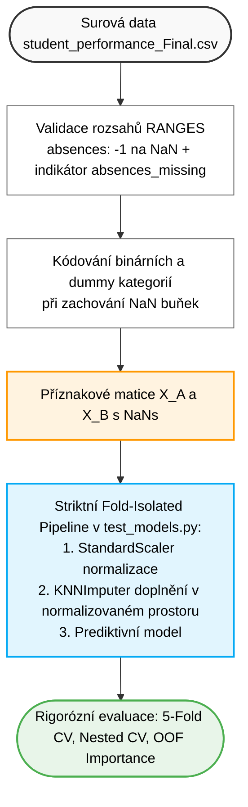

# VMM Projekt: Predikce studijních výsledků studentů (Student Performance)

Tento repozitář obsahuje kód pro semestrální projekt předmětu **MPC-VMM (Vícerozměrná analýza dat)** na FEKT VUT v Brně.
Cílem projektu je vícerozměrná analýza, testování statistických hypotéz a prediktivní modelování studijního úspěchu studentů na základě socio-demografických faktorů, rodinného zázemí a školních výsledků.

* Zdroj datasetu: [UCI Machine Learning Repository – Student Performance](https://archive.ics.uci.edu/dataset/320/student+performance)

---

## 1. Struktura repozitáře a rozdělení rolí

* **`scripts/clean_data.py`** – Samostatný čistící skript pro průzkum dat (EDA) a vizualizaci. Slouží výhradně pro generování ad-hoc tabulkového souboru pro počáteční exploraci a shlukovou analýzu. Výsledky modelování z něj nečerpají.
* **`scripts/test_models.py`** – Klíčový skript pro prediktivní modelování. Načítá surová data a veškeré transformace (škálování `StandardScaler` i imputaci `KNNImputer`) provádí striktně fold-isolated přímo uvnitř scikit-learn Pipelines, čímž eliminuje jakýkoliv únik dat (data leakage). Zahrnuje regresní i klasifikační benchmarky, nestranné ladění hyperparametrů pomocí Nested CV (5x5), ověření hypotéz a out-of-fold permutační důležitost příznaků.
* **`scripts/visualization_utils.py`** – Pomocný modul pro generování vektorových SVG grafů bez externích závislostí.
* **`data/raw/`** – Původní surový dataset `student_performance_Final.csv`.
* **`outputs/tables/`** – Výsledné srovnávací tabulky a metriky modelů (CSV).
* **`outputs/figures/`** – Vektorové grafy (SVG).
* **`outputs/model_testing_guide.md`** – Podrobný průvodce modelováním a technická zpráva pro obhajobu.

---

## 2. Rychlé spuštění

### Instalace závislostí
```bash
pip install -r requirements.txt
```

### 1. Spuštění čištění dat (volitelné – pro ad-hoc průzkum)
```bash
python scripts/clean_data.py
```
*Poznámka: Tento krok slouží pouze pro generování statického CSV pro EDA a vizualizaci. Pro samotné strojové učení není vyžadován.*

### 2. Spuštění kompletního testování prediktivních modelů (hlavní běh)
```bash
python scripts/test_models.py
```
Skript provede:
1. Analýzu citlivosti chybějící docházky (`absences == -1`).
2. Vyhodnocení regresních modelů ve Scénáři A (se známkami G1 a G2) i Scénáři B (včasné varování bez zkouškových známek) s fold-isolated Pipeline (`StandardScaler` -> `KNNImputer`).
3. Vyhodnocení klasifikačních modelů (vyvážená přesnost a recall pro identifikaci ohrožených studentů).
4. Nestranné ladění hyperparametrů pomocí Nested 5x5 Cross-Validation.
5. Statistické ověření 7 týmových hypotéz včetně přesných p-hodnot, velikostí účinku a Bonferroniho korekce.
6. Out-of-fold Grouped Permutation Feature Importance pro spravedlivé hodnocení vícedimenzionálních kategorií.
7. Export tabulek do `outputs/tables/` a grafů do `outputs/figures/`.

---

## 3. Schéma architektury předzpracování a modelování


