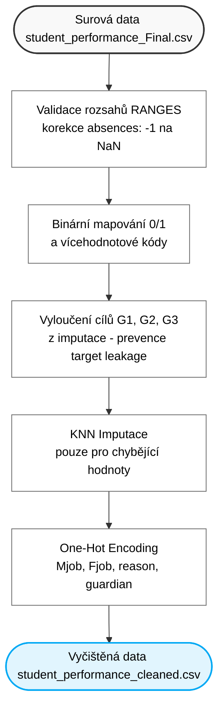

# VMM Projekt: Predikce studijních výsledků studentů (Student Performance)

Tento repozitář obsahuje kód pro semestrální projekt předmětu **MPC-VMM (Vícerozměrná analýza dat)** na FEKT VUT v Brně.
Cílem projektu je vícerozměrná analýza, testování statistických hypotéz a prediktivní modelování studijního úspěchu studentů na základě socio-demografických faktorů, rodinného zázemí a školních výsledků.

* Zdroj datasetu: [UCI Machine Learning Repository – Student Performance](https://archive.ics.uci.edu/dataset/320/student+performance)

---

## 1. Struktura repozitáře a rozdělení rolí

* **`scripts/clean_data.py`** – Předzpracování dat, validace rozsahů, ošetření chybějících hodnot (KNN imputace bez target leakage) a One-Hot kódování.
* **`scripts/test_models.py`** – Experimentální testování regresních a klasifikačních modelů, nestranné ladění hyperparametrů pomocí Nested CV (5x5) a ověření hypotéz.
* **`scripts/visualization_utils.py`** – Generování čistých vektorových SVG grafů bez závislostí.
* **`data/raw/`** – Původní surový dataset `student_performance_Final.csv`.
* **`data/processed/`** – Vyčištěná data připravená pro analýzu.
* **`outputs/tables/`** – Výsledné srovnávací tabulky a metriky modelů (CSV).
* **`outputs/figures/`** – Vektorové grafy (SVG).
* **`outputs/model_testing_guide.md`** – Podrobný průvodce modelováním a metodická zpráva pro obhajobu.

---

## 2. Rychlé spuštění

### Instalace závislostí
```bash
pip install -r requirements.txt
```

### 1. Spuštění čištění dat
```bash
python scripts/clean_data.py
```

### 2. Spuštění kompletního testování prediktivních modelů
```bash
python scripts/test_models.py
```
Skript provede:
1. Vyhodnocení regresních modelů ve Scénáři A (se známkami G1 a G2) i Scénáři B (včasné varování bez zkouškových známek).
2. Vyhodnocení klasifikačních modelů (vyvážená přesnost pro identifikaci ohrožených studentů).
3. Nestranné ladění hyperparametrů pomocí Nested 5x5 Cross-Validation.
4. Statistické ověření 7 týmových hypotéz na hladině významnosti $\alpha = 0.05$.
5. Grouped Permutation Feature Importance pro spravedlivé hodnocení vícedimenzionálních kategorií.
6. Export tabulek do `outputs/tables/` a grafů do `outputs/figures/`.

---

## 3. Schéma čištění dat


