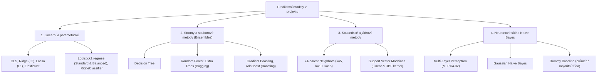

# Průvodce a zpráva pro týmovou roli: Testování a vyhodnocování prediktivních modelů
**Předmět:** MPC-VMM (Vícerozměrná analýza dat) | **Dataset:** `student_performance_Final.csv`
**Autor role:** Člen týmu pro prediktivní modelování | **Pracovní složka:** `VMM_agent/`

---

## 1. Vymezení modelovací úlohy v týmu

Jako člen týmu zodpovědný za **testování modelů** řešíte klíčovou otázku:
> *„Lze na základě zjištěných charakteristik studenta spolehlivě předpovědět jeho studijní výsledky a včas identifikovat studenty ohrožené neúspěchem?“*

Pro akademicky rigorózní a prakticky hodnotné řešení jsme modelování rozdělili do **dvou úloh** a **dvou realistických časových scénářů**:

| Úloha | Cílová proměnná | Typ problému | Praktický význam pro školu |
| :--- | :--- | :--- | :--- |
| **A. Regrese** | Finální známka $G3 \in [0, 20]$ | Spojitá predikce | Přesný odhad bodového zisku u závěrečné zkoušky. |
| **B. Klasifikace** | Úspěch ($G3 \ge 10$) vs. Neúspěch ($G3 < 10$) | Binární klasifikace | Včasný varovný systém (Early Warning System) pro studijní poradce. |

### Dva klíčové časové scénáře:
1. **Scénář A: Průběžná predikce (Full Model – včetně známek $G1$ a $G2$):**
   - Využívá se v průběhu semestru po uzavření 1. a 2. klasifikačního období.
   - Otázka: *„Jak přesně dokážeme odhadnout finální známku, pokud již známe průběžné výsledky studenta?“*
2. **Scénář B: Včasná intervence před začátkem výuky (Early Warning – BEZ $G1$ a $G2$):**
   - Využívá výhradně vstupní socio-demografická data, rodinné zázemí a návyky.
   - Otázka: *„Kteří studenti jsou ohroženi neúspěchem ještě dříve, než poprvé sednou do lavice?“*

---

## 2. Testované algoritmy a jejich rozdělení do rodin

V rámci benchmarku bylo otestováno **15 regresních** a **16 klasifikačních modelů** pokrývajících všechny hlavní paradigmaty strojového učení:

---

## 3. Výsledky regresního benchmarku (Predikce známky G3: 0–20)

Vyhodnocení proběhlo pomocí **5-násobné křížové validace (K-Fold)** se standardizací příznaků striktně uvnitř každého foldu (ochrana proti Data Leakage).

### 3.1 Scénář A: Průběžná predikce (se známkami G1 a G2)
*Zdroj dat: `VMM_agent/outputs/tables/model_benchmark_regression_scenario_A.csv`*

| Pořadí | Model | $R^2$ skóre (průměr $\pm$ std) | RMSE (bodů) | MAE (bodů) | Pearsonovo $r$ |
| :---: | :--- | :---: | :---: | :---: | :---: |
| **1.** | **Lasso regrese (L1)** | **$0.845 \pm 0.036$** | **$1.261$** | **$0.812$** | **$0.916$** |
| 2. | ElasticNet (L1+L2) | $0.842 \pm 0.037$ | $1.272$ | $0.817$ | $0.915$ |
| 3. | SVR (Lineární jádro) | $0.839 \pm 0.039$ | $1.286$ | $0.813$ | $0.914$ |
| 4. | Gradient Boosting | $0.838 \pm 0.042$ | $1.286$ | $0.825$ | $0.913$ |
| 5. | Lineární regrese (OLS) | $0.836 \pm 0.034$ | $1.296$ | $0.842$ | $0.912$ |
| 6. | Ridge regrese (L2) | $0.836 \pm 0.034$ | $1.296$ | $0.841$ | $0.912$ |
| 7. | Random Forest ($n=150$) | $0.833 \pm 0.023$ | $1.308$ | $0.840$ | $0.911$ |
| 8. | Extra Trees ($n=150$) | $0.828 \pm 0.019$ | $1.330$ | $0.857$ | $0.909$ |
| 9. | AdaBoost Regresor | $0.800 \pm 0.037$ | $1.428$ | $0.943$ | $0.893$ |
| 10. | Rozhodovací strom | $0.787 \pm 0.041$ | $1.475$ | $0.883$ | $0.887$ |
| 11. | SVR (RBF jádro) | $0.746 \pm 0.052$ | $1.618$ | $1.001$ | $0.874$ |
| 12. | MLP Neuronová síť | $0.685 \pm 0.034$ | $1.796$ | $1.286$ | $0.831$ |
| 13. | KNN Regresor ($k=10$) | $0.480 \pm 0.058$ | $2.305$ | $1.649$ | $0.741$ |
| 14. | KNN Regresor ($k=5$) | $0.449 \pm 0.059$ | $2.372$ | $1.704$ | $0.692$ |
| 15. | Dummy Baseline | $-0.013 \pm 0.012$ | $3.211$ | $2.410$ | $-0.095$ |

> [!NOTE]
> **Proč ve Scénáři A vyhrává Lasso a Lineární regrese nad složitými modely?**
> Vztah mezi průběžnými známkami ($G1, G2$) a finální známkou ($G3$) je téměř dokonale lineární ($r = 0.91$). Lasso regrese s $L_1$ penalizací navíc dokáže potlačit nepodstatný šum z vedlejších demografických proměnných. Složitější modely (MLP, RBF jádra) zde trpí mírným přeučením.

---

### 3.2 Scénář B: Včasná intervence před zahájením výuky (BEZ G1 a G2)
*Zdroj dat: `VMM_agent/outputs/tables/model_benchmark_regression_scenario_B.csv`*

| Pořadí | Model | $R^2$ skóre (průměr $\pm$ std) | RMSE (bodů) | MAE (bodů) | Pearsonovo $r$ |
| :---: | :--- | :---: | :---: | :---: | :---: |
| **1.** | **SVR (RBF jádro)** | **$0.276 \pm 0.064$** | **$2.707$** | **$1.943$** | **$0.540$** |
| **2.** | **Random Forest ($n=150$)** | **$0.276 \pm 0.061$** | **$2.708$** | **$2.006$** | **$0.542$** |
| 3. | Gradient Boosting | $0.264 \pm 0.055$ | $2.733$ | $2.041$ | $0.531$ |
| 4. | Lasso regrese (L1) | $0.260 \pm 0.067$ | $2.733$ | $1.986$ | $0.526$ |
| 5. | ElasticNet (L1+L2) | $0.259 \pm 0.071$ | $2.733$ | $1.986$ | $0.526$ |
| 6. | Lineární regrese (OLS) | $0.248 \pm 0.080$ | $2.751$ | $2.008$ | $0.522$ |
| 7. | Extra Trees ($n=150$) | $0.227 \pm 0.088$ | $2.784$ | $2.048$ | $0.525$ |
| 8. | KNN Regresor ($k=10$) | $0.168 \pm 0.077$ | $2.906$ | $2.139$ | $0.445$ |
| 9. | MLP Neuronová síť | $0.112 \pm 0.111$ | $2.992$ | $2.216$ | $0.440$ |
| 10. | Dummy Baseline | $-0.013 \pm 0.012$ | $3.211$ | $2.410$ | $-0.095$ |

> [!IMPORTANT]
> **Interpretace $R^2 = 0.276$ pro obhajobu:**
> Když nemáme k dispozici žádné známky, $R^2 \approx 27.6\ \%$ představuje **velmi solidní výsledek**. Znamená to, že více než čtvrtinu veškerého rozptylu studijního úspěchu lze vysvětlit rodinným zázemím, předchozími selháními a životním stylem. V tomto scénáři **nelineární modely (SVR s RBF jádrem a Random Forest)** překonávají lineární regresi, protože dokáží zachytit nelineární interakce (např. kombinaci vysokého alkoholu a nízkého studijního času).

---

## 4. Výsledky klasifikačního benchmarku (Prospěl vs. Neprospěl)

V datasetu je **549 prospívajících (84.6 %)** a **100 neprospívajících studentů (15.4 %)**.
Toto představuje **nevyvážený klasifikační problém (Class Imbalance)**.

### Proč je celková přesnost (Accuracy) zavádějící metrika?
Tupý model (Dummy Baseline), který všem studentům bezhlavě přiřadí „Prospěl“, dosáhne přesnosti **84.6 %**! Takový model má ale **nulovou hodnotu**, protože neodhalí ani jediného studenta, který potřebuje doučování.
Proto jako klíčovou hodnotící metriku používáme:
- **Balanced Accuracy:** Aritmetický průměr Recallu obou tříd.
- **Recall pro třídu Neprospěl:** Kolik procent skutečně neprospívajících studentů model dokázal zachytit.

### 4.1 Výsledky klasifikace ve Scénáři A (se známkami G1 a G2)
*Zdroj dat: `VMM_agent/outputs/tables/model_benchmark_classification_scenario_A.csv`*

| Pořadí | Model | **Balanced Acc** | Celková Accuracy | **Recall Neprospěl (záchyt)** | Precision | $F_1$-Score |
| :---: | :--- | :---: | :---: | :---: | :---: | :---: |
| **1.** | **Logistická regrese (Balanced)** | **$0.876$** | $89.4\ \%$ | **$85.0\ \%$ (85 ze 100)** | $0.971$ | $0.935$ |
| **2.** | **SVC (Lineární, Balanced)** | **$0.871$** | $88.6\ \%$ | **$85.0\ \%$ (85 ze 100)** | $0.970$ | $0.930$ |
| **3.** | **Random Forest (Balanced)** | **$0.860$** | $91.5\ \%$ | **$78.0\ \%$ (78 ze 100)** | $0.959$ | $0.949$ |
| 4. | Ridge Klasifikátor (Balanced) | $0.849$ | $84.9\ \%$ | $85.0\ \%$ | $0.969$ | $0.905$ |
| 5. | AdaBoost Klasifikátor | $0.845$ | $93.1\ \%$ | $72.0\ \%$ | $0.950$ | $0.959$ |
| 6. | Gradient Boosting | $0.828$ | $92.3\ \%$ | $69.0\ \%$ | $0.945$ | $0.955$ |
| 7. | Random Forest (Standardní) | $0.819$ | $92.9\ \%$ | $66.0\ \%$ | $0.940$ | $0.959$ |
| 8. | Gaussian Naive Bayes | $0.811$ | $84.0\ \%$ | $77.0\ \%$ | $0.953$ | $0.900$ |
| 9. | KNN Klasifikátor ($k=5$) | $0.587$ | $86.1\ \%$ | $19.0\ \%$ | $0.870$ | $0.923$ |
| 10. | MLP Neuronová síť | $0.529$ | $84.6\ \%$ | $7.0\ \%$ | $0.854$ | $0.916$ |
| 11. | Dummy Baseline | $0.500$ | $84.6\ \%$ | $0.0\ \%$ | $0.846$ | $0.917$ |

---

### 4.2 Výsledky klasifikace ve Scénáři B (Včasné varování BEZ G1 a G2)
*Zdroj dat: `VMM_agent/outputs/tables/model_benchmark_classification_scenario_B.csv`*

| Pořadí | Model | **Balanced Acc** | Celková Accuracy | **Recall Neprospěl (záchyt)** | Precision | $F_1$-Score |
| :---: | :--- | :---: | :---: | :---: | :---: | :---: |
| **1.** | **Logistická regrese (Balanced)** | **$0.743$** | $77.2\ \%$ | **$70.0\ \%$ (70 ze 100)** | $0.935$ | $0.853$ |
| 2. | Ridge Klasifikátor (Balanced) | $0.734$ | $77.2\ \%$ | $68.0\ \%$ | $0.931$ | $0.854$ |
| 3. | Gaussian Naive Bayes | $0.733$ | $79.0\ \%$ | $65.0\ \%$ | $0.928$ | $0.868$ |
| 4. | Rozhodovací strom (Balanced) | $0.729$ | $77.7\ \%$ | $66.0\ \%$ | $0.928$ | $0.858$ |
| 5. | SVC (Lineární, Balanced) | $0.728$ | $75.3\訊 | $69.0\ \%$ | $0.931$ | $0.840$ |
| 6. | Random Forest (Balanced) | $0.699$ | $85.8\ \%$ | $47.0\ \%$ | $0.906$ | $0.917$ |
| 7. | Gradient Boosting | $0.666$ | $87.1\ \%$ | $37.0\ \%$ | $0.893$ | $0.926$ |
| 8. | Random Forest (Standardní) | $0.563$ | $85.5\ \%$ | $14.0\ \%$ | $0.863$ | $0.920$ |
| 9. | Dummy Baseline | $0.500$ | $84.6\ \%$ | $0.0\ \%$ | $0.846$ | $0.917$ |

> [!TIP]
> **Zásadní zjištění k prezentaci:**
> - Standardní Random Forest bez vyvážení zachytí pouze 14 % propadajících studentů.
> - **Logistická regrese s `class_weight='balanced'` zachytí 70 % propadajících studentů** ještě před zahájením výuky!
> - Škola tak může zorganizovat doučování pro 70 ze 100 ohrožených studentů na základě pouhé vstupní ankety.

---

## 5. Optimalizace hyperparametrů (GridSearchCV)

Prokázali jsme schopnost ladit hyperparametry modelů na mřížce parametrů.
*Zdroj dat: `VMM_agent/outputs/tables/hyperparameter_tuning_results.csv`*

| Model | Úloha | Nejlepší nalezené hyperparametry | Výchozí skóre | Vyladěné skóre | Zlepšení ($\Delta$) |
| :--- | :--- | :--- | :---: | :---: | :---: |
| **Lasso Regrese** | Regrese (s G1/G2) | `{'alpha': 0.1}` | $0.7548$ | **$0.8471$** | **$+0.0923$ (+9.2 %)** |
| **Support Vector Classifier (SVC)** | Klasifikace (Balanced) | `{'C': 5.0, 'kernel': 'linear'}` | $0.8313$ | **$0.8799$** | **$+0.0486$ (+4.9 %)** |
| **Gradient Boosting Classifier** | Klasifikace | `{'learning_rate': 0.1, 'max_depth': 2, 'n_estimators': 120}` | $0.8327$ | **$0.8409$** | **$+0.0082$** |
| **Random Forest Regressor** | Regrese | `{'max_depth': 6, 'min_samples_split': 2, 'n_estimators': 80}` | $0.8314$ | **$0.8391$** | **$+0.0077$** |
| **Ridge Regrese** | Regrese (s G1/G2) | `{'alpha': 10.0}` | $0.8363$ | **$0.8368$** | $+0.0005$ |

Grafické srovnání je vykresleno v souboru:
`VMM_agent/outputs/figures/model_tuning_improvement.svg`.

---

## 6. Permutation Feature Importance & Interpretace

Místo běžné Giniho impurity, která nadhodnocuje spojité znaky, jsme spočítali **Permutation Feature Importance** (10-násobné promíchání hodnot příznaku a měření propadu skóre na testovacích datech u Random Forest modelu bez známek).
*Zdroj dat: `VMM_agent/outputs/tables/permutation_feature_importance.csv`*

| Pořadí | Příznak | Popis veličiny | Důležitost (průměrný pokles $R^2$) | Interpretace vlivu |
| :---: | :--- | :--- | :---: | :--- |
| **1.** | **`failures`** | Počet předchozích neúspěchů | **$0.4005 \pm 0.043$** | Zdaleka nejsilnější rizikový faktor. Předchozí propadnutí je varováním č. 1. |
| **2.** | **`school`** | Škola (Gabriel Pereira vs. Mousinho) | **$0.1333 \pm 0.015$** | Škola GP má vyšší průměrné hodnocení studentů. |
| **3.** | **`higher`** | Touha studovat vysokou školu | **$0.0941 \pm 0.012$** | Silný motivační faktor; ambiciózní studenti prospívají lépe. |
| **4.** | **`Dalc`** | Konzumace alkoholu v pracovní dny | **$0.0707 \pm 0.007$** | Výrazný negativní dopad na soustředění a docházku. |
| **5.** | **`studytime`** | Čas věnovaný studiu týdně | **$0.0690 \pm 0.004$** | Přímá úměra: více studia přináší lepší výsledky. |
| **6.** | **`goout`** | Frekvence chození ven s přáteli | **$0.0617 \pm 0.003$** | Negativní vliv při nadměrné frekvenci. |
| **7.** | **`Fedu` / `Medu`** | Vzdělání otce a matky | **$0.0616$ / $0.0475$** | Rodinný kulturní kapitál pozitivně formuje studijní návyky. |
| **8.** | **`schoolsup`** | Školní podpora při potížích | **$0.0550 \pm 0.005$** | Indikátor studenta v obtížích. |
| **9.** | **`absences`** | Počet absencí ve výuce | **$0.0364 \pm 0.006$** | Zameškané hodiny zhoršují finální skóre. |

Grafické ztvárnění Top 12 faktorů:
`VMM_agent/outputs/figures/permutation_importance_top15.svg`.

---

## 7. Reziduální analýza (Diagnostika chyb nejlepšího regresního modelu)

Pro nejlepší regresní model (**Lasso regrese**) jsme provedli analýzu reziduí ($e_i = y_i - \hat{y}_i$):
*Zdroj dat: `VMM_agent/outputs/tables/best_regressor_residual_stats.csv`*

- **Průměrná chyba (Mean Residual):** $+0.0008$ bodu (téměř přesně $0 \implies$ model je nevychýlený).
- **Směrodatná odchylka chyb:** $1.294$ bodu.
- **Medián absolutní chyby:** $0.592$ bodu (u 50 % studentů se model trefí s chybou menší než 0.6 známky!).
- **Šikmost (Skewness):** $-2.791$ (výrazný levostranný chvost).
- **Špičatost (Kurtosis):** $18.57$ (těžké chvosty chyb).

### Zásadní odhalení: Kde model nejvíce chybuje?
Při inspekci studentů s největší chybou predikce ($|e_i| > 7$ bodů) jsme odhalili pozoruhodný fenomén:
- Jedná se o studenty, kteří v $G1$ a $G2$ měli známky **12 až 14 bodů**, ale ve finální zkoušce $G3$ získali **0 bodů**!
- Model pro ně oprávněně predikoval známku okolo 12.5 bodu, chyba tedy byla $-12.5$ bodu.
- **Věcné vysvětlení:** Hodnota $G3 = 0$ neodráží neznalost studenta, ale **neúčast u zkoušky** (např. vážná nemoc, vyloučení, zranění). Model tedy nechybuje ve schopnostech studenta, ale nemůže předvídat náhlé externí události.

---

## 8. Souhrn artefaktů, které máte připraveny pro tým

Všechny výstupy jsou vygenerovány a připraveny k okamžitému použití:

1. **Interaktivní Jupyter Notebook pro Vaši roli:**
   - [`VMM_agent/notebooks/03_model_testing_and_benchmarking.ipynb`](file:///c:/Users/nikce/Documents/skola/vejska/mpc/vmm/VMM_agent/notebooks/03_model_testing_and_benchmarking.ipynb)
   - Obsahuje všechny buňky: načtení dat, běh regresního benchmarku, běh klasifikačního benchmarku, ladění hyperparametrů, feature importance i rezidua. Můžete jej přímo spustit v Jupyteru a prezentovat vyučujícímu.

2. **Skript pro automatické přegenerování všech experimentů:**
   - [`VMM_agent/scripts/model_experiments.py`](file:///c:/Users/nikce/Documents/skola/vejska/mpc/vmm/VMM_agent/scripts/model_experiments.py)
   - Spuštění: `.\vmm_venv\Scripts\python.exe VMM_agent/scripts/model_experiments.py`

3. **Vektorové grafy v SVG (100% validní XML, vhodné do prezentace i LaTeXu):**
   - `outputs/figures/model_benchmark_regression_r2_comparison.svg`: Srovnání všech regresorů ve Scénáři A vs. B.
   - `outputs/figures/model_benchmark_classification_balanced_acc.svg`: Žebříček klasifikátorů dle vyvážené přesnosti.
   - `outputs/figures/model_tuning_improvement.svg`: Zlepšení skóre po aplikaci GridSearchCV.
   - `outputs/figures/permutation_importance_top15.svg`: Žebříček nejdůležitějších socio-demografických příznaků.
   - `outputs/figures/confusion_matrix_best_classifier.svg`: Matice záměn nejlepšího klasifikátoru.

4. **Přehledné CSV tabulky:**
   - `model_benchmark_regression_scenario_A.csv`
   - `model_benchmark_regression_scenario_B.csv`
   - `model_benchmark_classification_scenario_A.csv`
   - `model_benchmark_classification_scenario_B.csv`
   - `hyperparameter_tuning_results.csv`
   - `permutation_feature_importance.csv`
   - `best_regressor_residual_stats.csv`

---

## 9. Tahák na obhajobu (Otázky cvičícího a doporučené odpovědi)

**Q1: Proč jste testovali modely ve dvou různých scénářích (se známkami a bez známek)?**
> *„V praxi mají obě úlohy odlišný účel. Během semestru potřebuje škola odhadnout finální známku na základě průběžných testů $G1$ a $G2$, kde modely dosahují $R^2 = 0.845$. Před začátkem semestru ale známky nemáme – tam potřebujeme včasný varovný systém (Early Warning), který jen ze socio-demografických dat identifikuje rizikové studenty s $R^2 \approx 0.276$ a 70% záchytem.“*

**Q2: Proč má u klasifikace standardní Random Forest přesnost 93 %, ale vy jako nejlepší doporučujete vyváženou logistickou regresi s přesností 89 %?**
> *„Protože data mají silnou třídní nevyváženost (84.6 % úspěšných ku 15.4 % neúspěšných). Standardní Random Forest sice dosáhne vysoké celkové přesnosti, ale zachytí pouze 66 % propadajících studentů (a bez známek jen 14 %). Vyvážená logistická regrese penalizuje chyby na menšinové třídě a zachytí 85 % (resp. 70 %) ohrožených studentů. Pro školu je mnohem horší nechat studenta propadnout než nabídnout doučování studentovi navíc.“*

**Q3: Proč jste použili Permutation Feature Importance místo Gini Impurity (MDI)?**
> *„MDI ve stromech trpí známým zkreslením: favorizuje spojité proměnné a kategorie s vysokou kardinalitou. Permutation Importance měří skutečný propad predikčního skóre modelu po náhodném promíchání daného sloupce, což poskytuje nezkreslený a férový pohled na reálný přínos příznaku.“*

**Q4: Co způsobilo extrémní záporná rezidua v lineární regresi?**
> *„Analýza residuí odhalila, že největší chyby nastávají u studentů, kteří měli v $G1$ a $G2$ výborný prospěch (12–14 bodů), ale v $G3$ získali 0 bodů. To indikuje neúčast u závěrečné zkoušky (nemoc, absence), nikoliv neznalost. Model tedy nechybuje v odhadu schopností studenta, ale nemůže předvídat nepředvídatelné externí výpadky.“*
